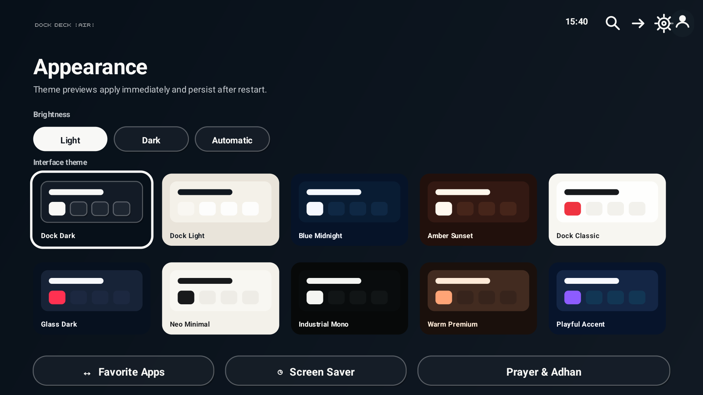
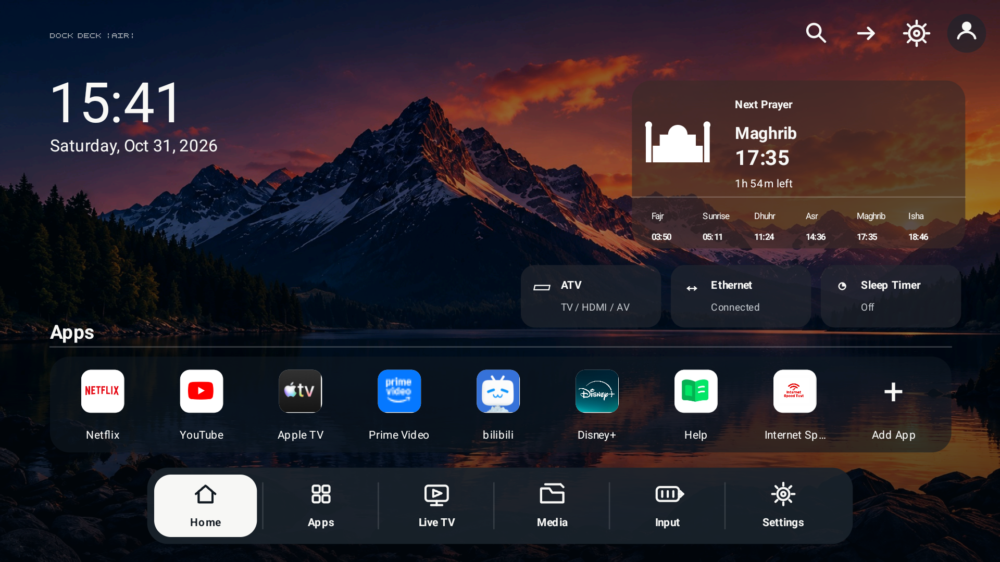
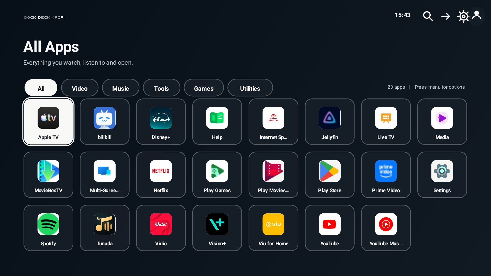
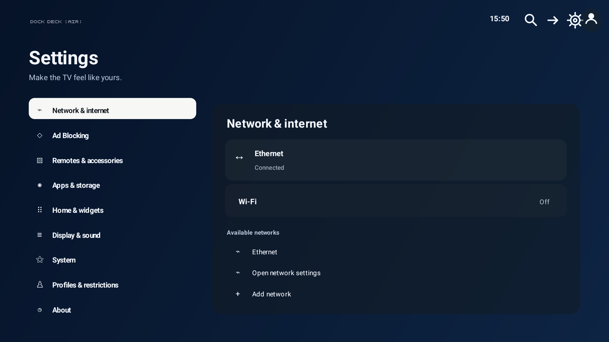
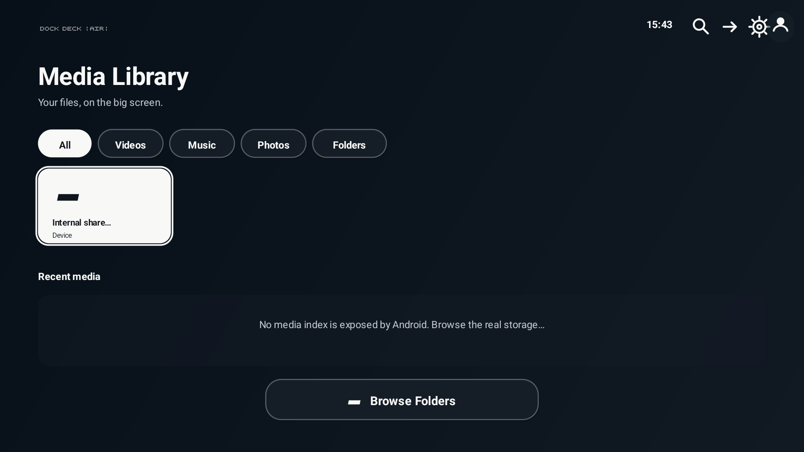
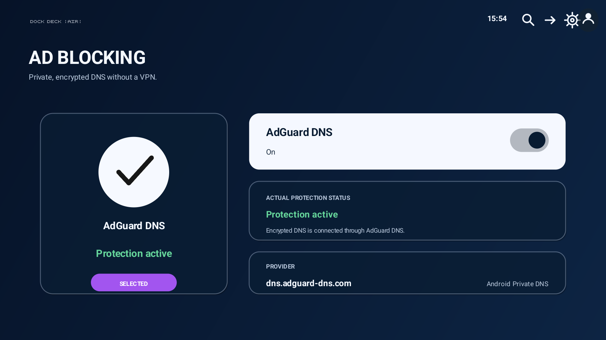

# Dock Deck Air

A lightweight, remote-first Android TV launcher with a cinematic wallpaper, compact app shelf, glass status cards, and a six-item bottom dock.

This project is a standalone visual fork of [CleanYourTV](https://github.com/Gathin23/cleanyourtv). It keeps the small Java/Canvas architecture and real Android TV integrations while restyling Home, All Apps, Inputs, Quick Settings, Search, Settings, Network, Remotes & Accessories, Picture & Sound, Media Library, Prayer & Adhan, Apps & Storage, Appearance, Live TV, and the clock screensaver.

## Highlights

- Android TV D-pad navigation and focus states on every screen
- Live analog clock and date
- Offline Indonesian prayer-time calculations, city/method selection, next-prayer countdown, and automatic Adhan
- Android 14-aware non-wakeup scheduling, reboot/time-change recovery, duplicate prevention, per-prayer selection, Full/Brief audio, independent volume, and Test Adhan
- Dynamic installed-app discovery, favorites, ordering, app details, and hiding
- Circular clipped app icons on Home, All Apps, Search, and App Options, with monochrome treatment where the selected theme calls for it
- Genuine TV input, network, Bluetooth, storage, audio, and package data when Android exposes it
- Optional AdGuard DNS protection with real Android Private DNS validation and exact restore of the previous DNS configuration
- Links to the TV's real system settings for restricted controls
- Dock Dark as the default design, plus Dock Light, Blue Midnight, Amber Sunset, and all six preserved legacy themes
- Manual Light, Manual Dark, and Automatic brightness behavior
- DreamService clock screensaver
- No analytics, telemetry, ads, or `INTERNET` permission

## Themes

Open **Settings → Home & Widgets → Appearance**. Every theme has an on-screen preview; selecting one applies it immediately and persists across launcher restarts and TV reboots.

The brightness controls retain Manual Light, Manual Dark, and Automatic behavior. The four Dock Deck themes keep the reference composition while changing its intended palette.

- **Dock Dark** — the primary reference theme: deep navy overlay, warm sunset mountain, translucent charcoal cards, and a white focus pill.
- **Dock Light** — the reference composition with a bright alpine treatment.
- **Blue Midnight** — dark blue night treatment with cool glass surfaces.
- **Amber Sunset** — warm orange/copper sunset treatment.
- **Preserved themes** — Dock Classic, Glass Dark, Neo Minimal, Industrial Mono, Warm Premium, and Playful Accent remain selectable.

Every image below is a real 1920×1080 capture from the running Changhong U55QCN1, not a mockup.

### Theme selection

[](docs/screenshots/themes/appearance-selector.png)

## More screens

Captured at 1920×1080 from a real Android TV. Select any image to open the full-resolution reference; the original files are in [`docs/screenshots`](docs/screenshots).

| Home | All Apps |
| --- | --- |
| [](docs/screenshots/home.png) | [](docs/screenshots/all-apps.png) |

| Settings | Appearance |
| --- | --- |
| [](docs/screenshots/settings.png) | [](docs/screenshots/themes/appearance-selector.png) |

### Media Library

[](docs/screenshots/media-library.png)

## Ad Blocking

Open **Settings → Ad Blocking** and press **AdGuard DNS**. When Android grants the launcher permission to manage protected settings, ON selects the public AdGuard DNS-over-TLS hostname `dns.adguard-dns.com`; OFF restores the exact Private DNS mode and hostname captured before it was enabled. The screen reads Android's active `LinkProperties`, so **Protection active**, **Waiting for network**, and **Connection error** describe the real resolver state rather than the switch position.

[](docs/screenshots/ad-blocking.png)

Android protects Private DNS changes with `WRITE_SECURE_SETTINGS`. Cardflow never asks for a root shell and the installer does not silently grant this permission. On a trusted development TV, automatic switching can be enabled explicitly over ADB:

```sh
adb shell pm grant com.gathin.tvhome android.permission.WRITE_SECURE_SETTINGS
```

Without that grant, the control opens Android's supported Private DNS settings flow (or the main TV Settings screen when vendor firmware does not publish a dedicated Private DNS activity). Set **Private DNS provider hostname** to `dns.adguard-dns.com`; returning to Cardflow refreshes the actual status.

This is DNS-level filtering, not content rewriting. It blocks many advertising, tracking, phishing, and telemetry hostnames, but cannot reliably remove ads delivered from the same domains as requested content—most notably some official YouTube video ads. The official YouTube app is neither replaced nor modified. Some networks or streaming services may reject encrypted DNS; switch the control OFF to restore the saved DNS configuration.

The feature uses Android Private DNS directly. It adds no VPN service, background polling, third-party client, analytics, or launcher `INTERNET` permission. Local discovery such as Chromecast and screen mirroring remains on Android's normal network path.

## Requirements

- Android TV 8.0 / API 26 or newer
- JDK 17
- Android SDK Platform 34 and Build Tools 34
- ADB enabled on the TV for installation

Tested on a Changhong U55QCN1 running Android TV 14. Vendor firmware differs, so some system panels or remote buttons may not be exposed on another TV.

## Build

```sh
./gradlew --no-daemon testReleaseUnitTest lintRelease assembleRelease
```

The APK is generated locally at:

```text
app/build/outputs/apk/release/app-release.apk
```

Compiled APKs are intentionally not committed to this repository.

## Install safely

Connect the TV through Android's Wireless debugging or Network debugging, then run:

```sh
TV_HOST=<tv-ip> ./build-and-install.sh
```

Windows PowerShell:

```powershell
./build-and-install.ps1 -TvAddress <tv-ip>
```

The installer does **not** uninstall or disable the stock launcher or any system package. It builds from source, installs Dock Deck Air, starts it, and asks Android to make it Home. If the firmware ignores `set-home-activity`, select Dock Deck Air in the TV's Home-app/default-app settings.

To revert, select the original launcher in Android TV Settings. Keep ADB enabled until the new launcher has survived a reboot and the original Home can still be selected.

## Prayer and Adhan

Open **Settings → Home & Widgets → Prayer & Adhan** to choose the city and calculation method, enable or disable automatic playback, set the independent Adhan volume, choose Full (2 minutes 24 seconds) or Brief (20 seconds), select individual prayers, and run **Test Adhan**. Sunrise is displayed but is not an Adhan event.

On Android 12 or newer, grant **Exact scheduling** from that screen for minute-accurate delivery. The fallback is an inexact non-wakeup alarm. The launcher does not wake a TV that is in standby, skips stale alarms after wake, and reschedules after reboot, package replacement, clock changes, and timezone changes.

The bundled recording is a locally encoded copy of [`Beautiful adhan.ogg`](https://commons.wikimedia.org/wiki/File:Beautiful_adhan.ogg) by Adam-synagda, with five seconds removed from both the start and end. The author dedicated it to the public domain under CC0 1.0. Playback needs no network connection.

## Platform limitations

- HDMI switching, picture controls, audio controls, sleep timers, channel data, and pairing screens depend on APIs/actions published by the TV firmware.
- The launcher never invents channel lists, media entries, connection state, or device status.
- A physical Settings, Input, or Profile button only reaches the launcher when the firmware dispatches its Android key event. Injected ADB keys are not proof that a physical remote button works.
- Prayer calculations are performed locally and do not require network access. Confirm the selected city and calculation method against your local authority.

## Privacy

Dock Deck Air has no Internet permission and does not include analytics. Do not publish screenshots containing Wi-Fi names, account details, device names, serial numbers, or other personal identifiers.

## License and credits

MIT licensed. See [LICENSE](LICENSE).

- Original CleanYourTV launcher: Gathin
- Standalone launcher fork and TV-specific work: angger43
- Dock Deck Air reference implementation and Adhan integration: this project
- Outfit typeface: The Outfit Project Authors, licensed under SIL Open Font License 1.1; see [FONT-LICENSE-OFL.txt](FONT-LICENSE-OFL.txt)
